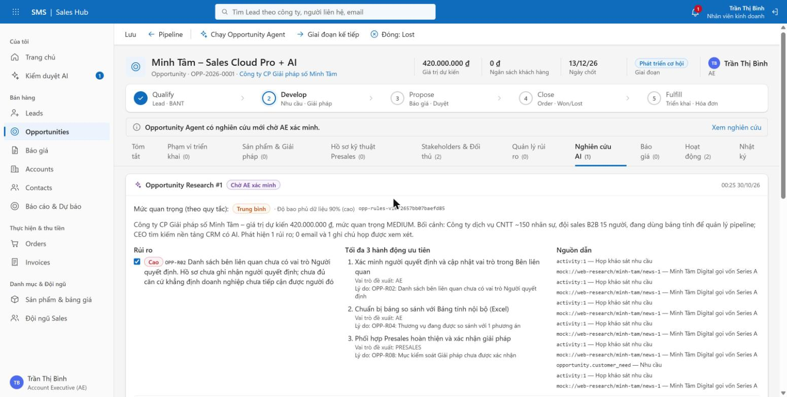
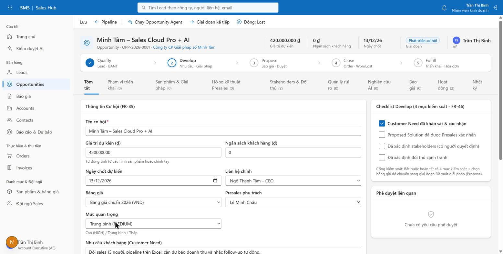
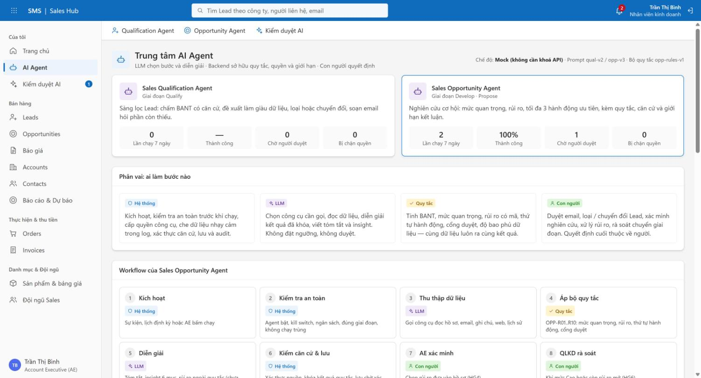
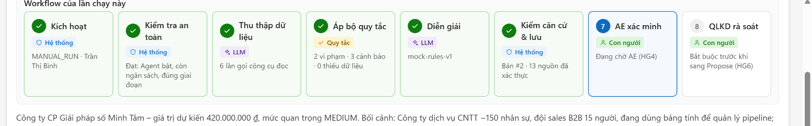
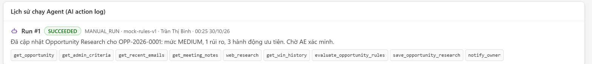
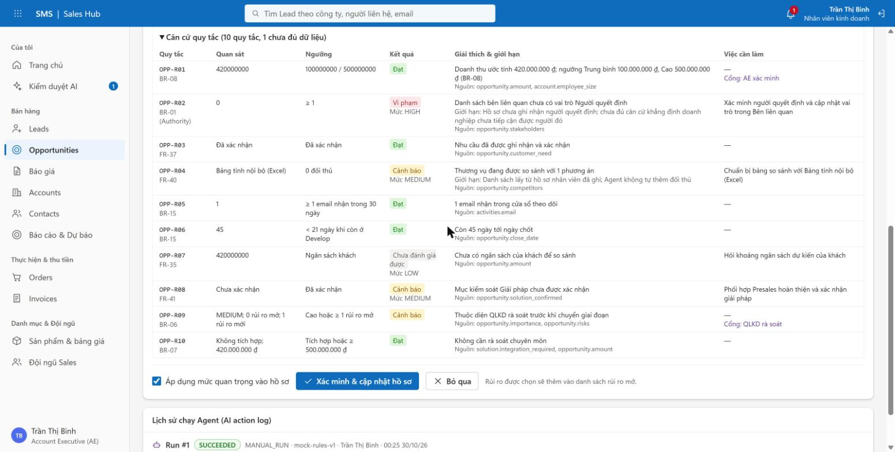
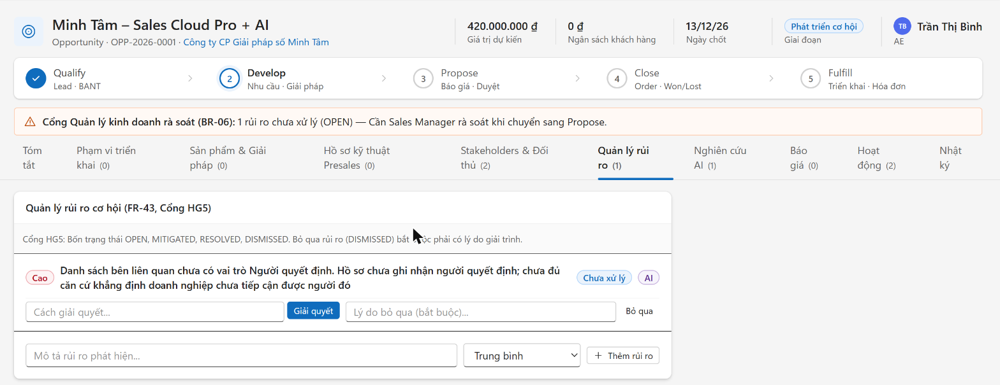
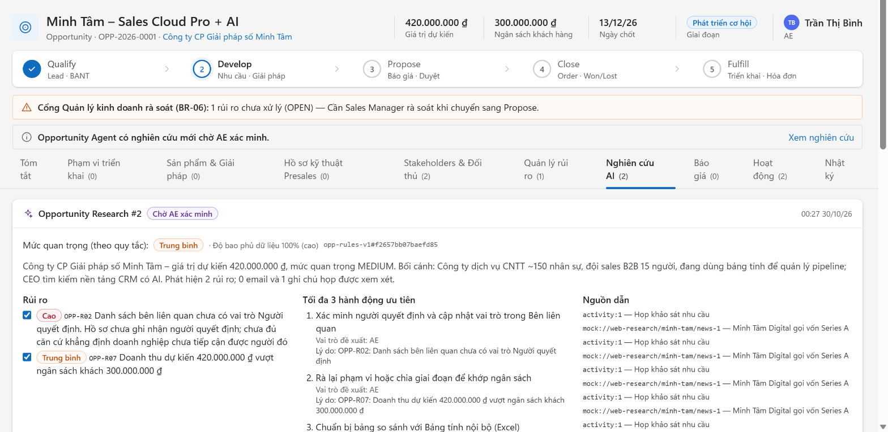
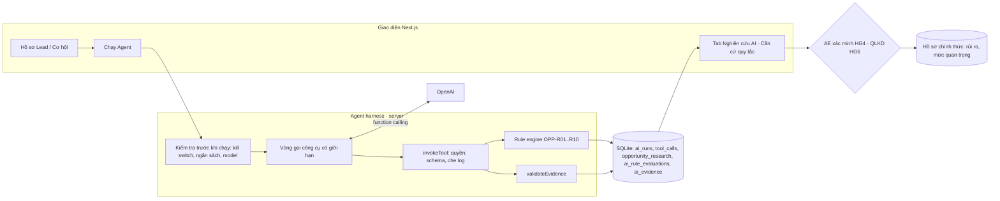

# SMS – Agentic Sales Management System

> Đồ án môn Kiến trúc Hệ thống (UEH): hệ thống quản lý Sales B2B SaaS có hai AI Agent được kiểm soát bằng quy tắc, căn cứ và cổng duyệt của con người.

Repository này vừa là mã nguồn chạy được, vừa là bản trình bày kiến trúc. Nó cho thấy một Agent có thể đi từ dữ liệu bán hàng rời rạc tới một nhận định **có quy tắc, có căn cứ, có giới hạn kết luận**, để nhân viên kinh doanh xác minh, quản lý rà soát và mọi bước đều truy vết được.



## Câu chuyện của đồ án

Kịch bản xuyên suốt là cơ hội **Minh Tâm – Sales Cloud Pro + AI** (OPP-2026-0001) của Công ty CP Giải pháp số Minh Tâm, do AE **Trần Thị Bình** phụ trách:

- Giá trị dự kiến: **420 000 000 ₫**, giai đoạn **Develop**, ngày chốt 13/12/2026
- Nhu cầu: đội sales 15 người đang quản lý pipeline bằng Excel, cần dự báo doanh thu và nhắc follow-up
- Điểm mở: chưa ghi nhận **người quyết định**, khách đang so sánh với **bảng tính nội bộ (Excel)**, giải pháp chưa được Presales xác nhận
- Dữ kiện thay đổi: khách báo **ngân sách 300 000 000 ₫** — thấp hơn giá trị dự kiến

Hệ thống biến kịch bản đó thành bản **Opportunity Research** có phiên bản. Phần trình diễn cho thấy bản #1, việc AE xác minh, dữ kiện ngân sách thay đổi và bản #2 với rủi ro mới được giải thích bằng quy tắc.

## Hệ thống làm gì

Luồng chủ động được thiết kế để không chỉ là một lần gọi LLM:

1. Lead vào hệ thống; **Sales Qualification Agent** chấm BANT có căn cứ, đề xuất làm giàu / loại / chuyển đổi, soạn email hỏi thêm.
2. SDR duyệt từng đề xuất (HG1–HG3); chuyển đổi tạo cơ hội ở giai đoạn Develop.
3. **Sales Opportunity Agent** chạy khi có sự kiện, theo lịch 6 giờ, hoặc khi AE bấm chạy.
4. Agent đọc hồ sơ, email, ghi chú họp, nghiên cứu web qua công cụ được cấp quyền.
5. Backend chạy **bộ quy tắc OPP-R01..R10** (BR-28): mức quan trọng, rủi ro, thứ tự hành động, cổng duyệt, độ bao phủ dữ liệu.
6. OpenAI diễn giải kết quả đã khóa và viết insight; mọi nguồn dẫn được server xác thực.
7. AE xác minh bản nghiên cứu (HG4) mới chép rủi ro vào hồ sơ; cơ hội mức Cao hoặc còn rủi ro phải qua QLKD (HG6).
8. Dữ kiện trọng yếu thay đổi → Agent chạy lại, bản cũ vẫn giữ để so sánh.
9. Mỗi lần chạy lưu lần chạy, công cụ đã gọi, căn cứ, kết quả từng quy tắc và hash bộ quy tắc.

## Product walkthrough

### 1. Bắt đầu từ dữ liệu thật của thương vụ

AE ghi nhu cầu, ngân sách, ngày chốt, liên hệ, bảng giá và checklist 4 mục kiểm soát của giai đoạn Develop. Đây là dữ liệu Agent được phép đọc.



### 2. Mỗi Agent có hồ sơ rõ ràng

Trang **Trung tâm AI Agent** (`/agents`) trình bày từng Agent theo 6 thành phần: nhiệm vụ & kích hoạt, công cụ (đọc / ghi), quy tắc, việc không được làm, cổng con người, đầu ra & dấu vết; kèm workflow 8 bước có nhãn **ai làm bước đó** (Hệ thống / LLM / Quy tắc / Con người), giới hạn vận hành và thống kê lần chạy. Nội dung đọc từ registry công cụ, bộ quy tắc và cấu hình thật, không phải mô tả tĩnh.



### 3. Làm cho từng bước của một lần chạy nhìn thấy được

Mỗi bản nghiên cứu có thanh **Workflow của lần chạy này**: bước nào đã xong, do ai làm, kết quả tóm tắt (số công cụ đã gọi, số vi phạm / cảnh báo / thiếu dữ liệu, số nguồn đã xác thực) và bước nào đang chờ con người.



Lịch sử chạy ghi đúng thứ tự công cụ đã gọi, trong đó có `evaluate_opportunity_rules` và công cụ ghi duy nhất `save_opportunity_research`. Công cụ sai quyền bị chặn và ghi DENIED.



### 4. Giải thích kết luận bằng quy tắc

Bảng **Căn cứ quy tắc** cho thấy quy tắc nào, giá trị quan sát, ngưỡng, kết quả, giới hạn kết luận, việc cần làm và cổng duyệt. Thiếu dữ liệu thì ghi *Chưa đánh giá được* thay vì đoán.



### 5. Con người xác minh trước khi hồ sơ thay đổi

AE chọn rủi ro nào được thêm vào hồ sơ. Rủi ro OPP-R02 vào tab Quản lý rủi ro (gắn nhãn AI) và **cổng QLKD rà soát (BR-06)** bật lên trước khi được chuyển sang Propose.



### 6. Dữ kiện thay đổi được đánh giá lại

Khách báo ngân sách 300 triệu. Agent chạy lại: độ bao phủ dữ liệu lên 100 %, **OPP-R07 chuyển thành vi phạm** (420 triệu > 300 triệu) và hành động "rà lại phạm vi hoặc chia giai đoạn" lên vị trí thứ hai. Bản #1 vẫn được giữ.



### 7. Giữ dấu vết để kiểm tra lại

Mỗi bản nghiên cứu gắn với lần chạy, phiên bản cấu hình Agent, `ruleset_version` + `ruleset_hash`, người xác minh và nhật ký audit (kể cả khi LLM đề xuất mức quan trọng khác quy tắc). Xem [03 · Bộ nhớ hồ sơ và truy xuất](docs/whitepapers/03-record-memory-and-retrieval.md).

## Quyết định thiết kế

<details>
<summary>Kiến trúc đầy đủ và ranh giới dữ liệu</summary>



</details>

Ranh giới trung tâm rất đơn giản:

- **Backend** sở hữu ngưỡng, trạng thái quy tắc, quyền công cụ, kiểm tra căn cứ, giới hạn chạy, lưu trữ và audit.
- **OpenAI** chọn bước, gọi công cụ, diễn giải kết quả đã khóa và viết insight bằng structured output.
- **Agent** bị giới hạn bởi danh sách công cụ, đúng một hồ sơ (`ctx.entityId`), schema đầu ra và bộ quy tắc.
- **Con người** duyệt email, loại / chuyển đổi Lead, xác minh nghiên cứu, rà soát chuyển giai đoạn và chiết khấu.

Thất bại an toàn là một kết quả hợp lệ: thiếu dữ liệu, căn cứ không xác thực được, lỗi provider, vượt ngân sách hay sai schema đều dừng hoặc chuyển người xem, không tạo ra một kết quả trông như chắc chắn.

## Cấu trúc repository

- `src/app/` – trang Next.js (App Router) và API route
- `src/lib/agents/` – harness của 2 Agent: `runtime`, `tools`, `rules`, `evidence`, `prompts`, `mock`
- `src/lib/services/` – nghiệp vụ Lead, cơ hội, báo giá, đơn hàng, hoá đơn, quản trị AI
- `src/lib/db/` – schema SQLite, migration theo gói việc `wpXX_*`, dữ liệu mẫu
- `src/components/` – thành phần giao diện, gồm bảng Căn cứ quy tắc
- `tests/` – test Vitest theo gói việc (DB in-memory, AI mock)
- `docs/whitepapers/` – 7 tài liệu kiến trúc; `docs/requirements/` – FR, BR, quyết định, mô hình dữ liệu
- `assets/` – ảnh chụp walkthrough
- `Dockerfile`, `.github/workflows/ci.yml` – build và CI

## Chạy local

```sh
npm ci
cp .env.example .env.local
npm run dev
```

Mở [http://localhost:3000](http://localhost:3000). Lần chạy đầu hệ thống tự tạo dữ liệu mẫu trong `data/sms.db`. Không có `OPENAI_API_KEY` thì Agent chạy chế độ mock, đi đúng các công cụ, quyền và quy tắc như bản thật.

```sh
npm run typecheck    # Sinh type route và kiểm tra kiểu TypeScript
npm run lint         # ESLint
npm test             # Vitest (DB in-memory, mock AI)
npm run check        # typecheck + lint + test
npm run db:reset     # Tạo lại cơ sở dữ liệu mẫu
npm run fr:coverage  # Độ phủ kiểm thử theo mã FR và HG
npm run build        # Build production
```

Tài khoản demo (mật khẩu chung `Password123!`, hoặc chọn nhanh ở `/login`):

| Vai trò | Nhãn hiển thị | Email | Họ và tên | Chức danh | Mã NV |
| :--- | :--- | :--- | :--- | :--- | :--- |
| `SALES` | Nhân viên kinh doanh | `an.nguyen@sms.local` | Nguyễn Văn An | SDR (Sales Development Rep) | `EMP-001` |
| `SALES` | Nhân viên kinh doanh | `binh.tran@sms.local` | Trần Thị Bình | Account Executive (AE) | `EMP-002` |
| `PRESALES` | Chuyên viên tư vấn kỹ thuật | `chau.le@sms.local` | Lê Minh Châu | Solution Engineer (SE) | `EMP-003` |
| `PRESALES_MANAGER` | Quản lý tư vấn giải pháp | `phuc.ngo@sms.local` | Ngô Tuấn Phúc | Quản lý tư vấn giải pháp | `EMP-004` |
| `SALES_MANAGER` | Quản lý kinh doanh | `dung.pham@sms.local` | Phạm Quốc Dũng | Quản lý kinh doanh | `EMP-005` |
| `FINANCE` | Nhân viên Tài chính – Kế toán | `ha.vo@sms.local` | Võ Thu Hà | Kế toán công nợ | `EMP-006` |
| `AI_MANAGER` | Người quản lý tác nhân AI | `tuan.le@sms.local` | Lê Hoàng Tuấn | Quản lý tác nhân AI | `EMP-007` |
| `ADMIN` | Người quản trị hệ thống | `khanh.hoang@sms.local` | Hoàng Gia Khánh | Quản trị hệ thống | `EMP-008` |

Kịch bản thao tác từng bước: [docs/demo-walkthrough.md](docs/demo-walkthrough.md).

## Tài liệu kiến trúc

| Whitepaper | Nội dung |
| :---- | :---- |
| [01 · Hai Agent và harness](docs/whitepapers/01-agent-harness.md) | Các lớp của một Agent, vòng gọi công cụ có giới hạn, mock và OpenAI |
| [02 · Bảo vệ dữ liệu và đầu vào không tin cậy](docs/whitepapers/02-data-protection-and-untrusted-input.md) | Che log, `untrusted_data`, kiểm tra căn cứ, ranh giới tin cậy |
| [03 · Bộ nhớ hồ sơ và truy xuất](docs/whitepapers/03-record-memory-and-retrieval.md) | Bảng dữ liệu AI, `ai_rule_evaluations`, hai đường truy vết |
| [04 · Mô hình quyết định và quyền sở hữu](docs/whitepapers/04-decision-model-and-ownership.md) | OPP-R01..R10, trạng thái, độ bao phủ, ai sở hữu phần nào |
| [05 · Cổng con người, chạy lại và quản trị](docs/whitepapers/05-human-gates-revision-and-governance.md) | HG1–HG8, kiểm soát vận hành, bản #1 / #2 trước–sau |
| [06 · Hỏi đáp bảo vệ kỹ thuật](docs/whitepapers/06-technical-defense-qa.md) | Câu trả lời ngắn cho phần hỏi đáp |
| [07 · Bản đồ triển khai](docs/whitepapers/07-implementation-map.md) | Màn hình → code → test, việc còn mở |

Yêu cầu và quy ước của nhóm: [AGENTS.md](AGENTS.md), [REQUIREMENTS](docs/requirements/REQUIREMENTS.md), [BUSINESS-RULES](docs/requirements/BUSINESS-RULES.md), [DECISIONS](docs/requirements/DECISIONS.md), [ROLES](docs/requirements/ROLES.md), [DATA-MODEL](docs/requirements/DATA-MODEL.md), [WORKPLAN](docs/WORKPLAN.md), [DEPLOY](docs/DEPLOY.md), [VIBECODE-GUIDE](docs/VIBECODE-GUIDE.md).

## Giới hạn

Đây là prototype cho đồ án, không phải hệ thống vận hành thật. Chế độ mock dùng dữ liệu web mẫu (`mock://…`), không chứng minh Agent đã tra cứu Internet. Chưa có: bộ đánh giá 45 ca chạy với model OpenAI thật, bảng quy tắc riêng cho Qualification Agent, test tự động cho bước AE xác minh, SSO/MFA, quét mã độc tệp tải lên, sao lưu và chính sách xoá dữ liệu tự động. SQLite phù hợp một máy chủ; triển khai nhiều phiên bản cần cơ sở dữ liệu dùng chung.

## License

Chưa gắn license. Mã nguồn thuộc đồ án môn học của nhóm.
