# 01 · Hai Agent và Harness

> **Mục đích.** SMS dùng hai AI Agent cho hai giai đoạn đầu của quy trình Sales. Một lần gọi LLM không phải là một quyết định: mỗi Agent chạy trong một *harness* có quyền, công cụ, giới hạn, quy tắc và đầu ra riêng; con người là người quyết định cuối.

## 1. Một Agent gồm những lớp nào?

| Lớp | Sales Qualification Agent | Sales Opportunity Agent | Ở đâu trong code |
|---|---|---|---|
| Nhiệm vụ nghiệp vụ | Sàng lọc Lead, chấm BANT, đề xuất làm giàu / loại / chuyển đổi, soạn email hỏi thêm | Nghiên cứu cơ hội ở Develop/Propose, mức quan trọng, rủi ro, 3 hành động ưu tiên | `src/lib/agents/prompts.ts` |
| Context được cấp quyền | Chỉ Lead đang chạy (`ctx.entityId`), không nhận ID từ model | Chỉ Opportunity đang chạy | `tools.ts` → `leadOf`, `oppOf` |
| System prompt | `qual-v2` | `opp-v3` (gọi bộ quy tắc trước khi ghi) | `prompts.ts`, cấu hình phiên bản ở `agent_configs` |
| Công cụ | 12 công cụ: 6 đọc, 6 chỉ tạo đề xuất chờ duyệt | 9 công cụ: 7 đọc (có `evaluate_opportunity_rules`), 2 ghi | `TOOLS` trong `tools.ts` |
| Kiểm soát deterministic | Ép `NEED_INFO` khi confidence < 0,6; kiểm căn cứ | **Rule engine OPP-R01..R10** khóa mức quan trọng, rủi ro, thứ tự hành động, cổng duyệt | `tools.ts`, `rules.ts`, `evidence.ts` |
| Đầu ra | `ai_suggestions` chờ duyệt | `opportunity_research` + `ai_rule_evaluations` chờ AE xác minh | migration `wp08_*` |

**Nguyên tắc cốt lõi:** LLM chọn bước và diễn giải; backend quyết định công cụ nào được gọi, ngưỡng nào là chính thức, dữ liệu nào hợp lệ và khi nào con người phải duyệt.

## 2. Luồng một lần chạy

```mermaid
flowchart LR
    T[Sự kiện / lịch 6 giờ / bấm chạy] --> P[Kiểm tra trước khi chạy]
    P -->|Kill switch, ngân sách, Agent bật, giai đoạn hợp lệ, không chạy trùng| R[Tạo ai_runs RUNNING]
    R --> L[Vòng gọi công cụ có giới hạn]
    L --> V[Kiểm quyền + schema + căn cứ]
    V --> E[Rule engine OPP-R01..R10]
    E --> S[Lưu kết quả PENDING_REVIEW]
    S --> H[AE xác minh / QLKD rà soát]
```



Trước khi chạy (`runtime.ts`): Agent phải đang bật, Kill switch tắt, còn ngân sách token ngày (BR-16), đúng loại hồ sơ, đúng giai đoạn, không có lần chạy RUNNING trùng, model nằm trong danh sách cho phép (BR-25).

## 3. Vòng gọi công cụ có giới hạn

```text
LLM trả tool call → invokeTool()
  → công cụ có tồn tại? Agent có quyền? (sai → DENIED, ghi tool_calls)
  → đầu vào đúng schema zod?
  → chạy trên đúng bản ghi của lần chạy
  → che email/SĐT/khoá trước khi ghi log (DEC-28)
  → trả kết quả có cấu trúc về cho LLM
```

Giới hạn mỗi lần chạy: tối đa 15 vòng (BR-16), 60 000 token và 5 lượt tìm web (BR-24), hết thời gian `ai_run_timeout_sec` thì FAILED. Vượt giới hạn → dừng và ghi lý do, không tạo kết quả giả.

## 4. Chế độ mock và chế độ thật

- `SMS_AI_MODE=mock` hoặc không có `OPENAI_API_KEY` → kịch bản mock đi **đúng các công cụ, quyền và rule engine** như bản thật, nên luồng kiểm duyệt và log giống hệt.
- Có khoá OpenAI (DEC-12) → `runWithLlm` dùng function calling.
- Mock **không** chứng minh Agent đã tra cứu Internet: nguồn `mock://…` là dữ liệu mẫu.

## 5. Agent không được làm gì

| Opportunity Agent không được | Chặn bằng |
|---|---|
| Sửa doanh thu, ngày chốt, giai đoạn, giá, checklist | Không có công cụ ghi tương ứng |
| Tự thêm đối thủ / rủi ro vào hồ sơ chính thức | Chỉ ghi bản nghiên cứu; AE chọn rủi ro khi xác minh (HG4) |
| Tự đặt mức quan trọng | Backend thay bằng kết quả OPP-R01, lưu giá trị LLM vào `llm_importance` |
| Dẫn nguồn không có thật | `validateEvidence` đối chiếu trường, activity, URL của chính lần chạy |
| Làm theo chỉ dẫn trong email/web | Bọc `untrusted_data`; prompt cấm làm theo |
