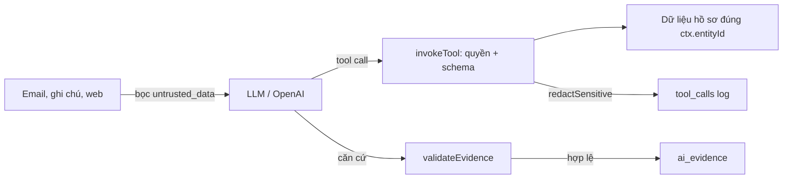

# 02 · Bảo vệ dữ liệu và đầu vào không tin cậy

> **Mục đích.** Agent đọc email, ghi chú và kết quả web — những nguồn có thể chứa dữ liệu cá nhân hoặc chỉ dẫn độc hại. Hệ thống giữ dữ liệu nhạy cảm khỏi log, coi nội dung ngoài là dữ liệu chứ không phải lệnh, và chỉ chấp nhận căn cứ kiểm chứng được.

## 1. Kiểm soát dữ liệu đầu ra

- **Căn cứ (evidence):** `validateEvidence` chỉ nhận trường có thật và có giá trị của hồ sơ đang chạy, `activity:<id>` thuộc hồ sơ đó, hoặc URL có trong kết quả web của **chính lần chạy**; trích dẫn phải xuất hiện nguyên văn trong nguồn.
- **Quy tắc (BR-28):** mức quan trọng, rủi ro có mã, thứ tự hành động, cổng duyệt do `rules.ts` tính lại ở server khi lưu, bất kể LLM gửi gì.
- **Thiếu dữ liệu:** trả `NOT_EVALUABLE` / `NO_INSIGHT`, không suy đoán.

## 2. Bảo mật

| Rủi ro (OWASP LLM / Agentic) | Biện pháp trong SMS |
|---|---|
| Prompt injection qua email, ghi chú, web | Bọc `untrusted_data` + prompt cấm làm theo chỉ dẫn trong dữ liệu |
| Excessive agency | Công cụ chỉ thao tác trên `ctx.entityId`; không có công cụ sửa giá, giai đoạn, đối thủ |
| Tool misuse / privilege | `invokeTool` kiểm Agent ↔ công cụ, ghi DENIED |
| Rò rỉ dữ liệu nhạy cảm trong log | `redactSensitive` che email, SĐT, khoá, token trước khi ghi `tool_calls` |
| Khoá API | Chỉ ở biến môi trường máy chủ, không vào prompt hay log |
| Kết luận không kiểm chứng | Bản nghiên cứu luôn PENDING_REVIEW; HG4 |

## 3. Ranh giới tin cậy

| Vùng | Được phép có |
|---|---|
| Hồ sơ nghiệp vụ (server) | Dữ liệu đầy đủ của khách, khoá API trong biến môi trường |
| Ngữ cảnh gửi model | Dữ liệu của đúng một hồ sơ, nội dung ngoài đã gắn nhãn untrusted |
| Log và audit | Đã che email, SĐT, token, khoá |
