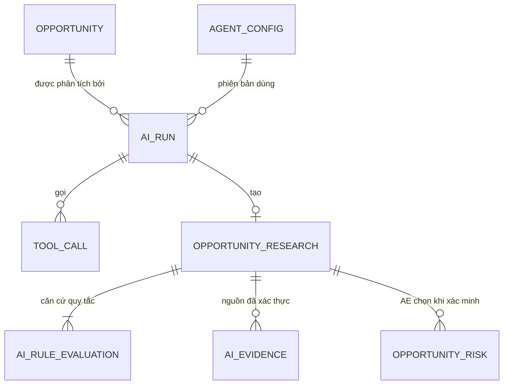

# 03 · Dữ liệu của lớp AI

> **Mục đích.** LLM không có bộ nhớ bền vững. Mọi thứ cần để truy vết "Agent đã làm gì, dựa vào đâu, ai duyệt" nằm trong cơ sở dữ liệu, gắn với hồ sơ nghiệp vụ (Lead / Opportunity).

## 1. Các bảng và vai trò

| Thực thể ERD | Bảng | Trả lời câu hỏi |
|---|---|---|
| AGENT, AGENT_CONFIG | `agents`, `agent_configs` | Agent nào, phiên bản prompt/model nào đang hiệu lực (DEC-27, BR-25) |
| TOOL, TOOL_GRANT | `tools`, `tool_grants` | Agent được dùng công cụ nào |
| AGENT_RUN | `ai_runs` | Lần chạy nào, ai/sự kiện nào kích hoạt, token, chi phí, trạng thái, lỗi |
| TOOL_CALL | `tool_calls` | Từng lần gọi công cụ: OK / ERROR / **DENIED**, đầu vào đã che |
| AI_RESULT | `ai_suggestions`, `opportunity_research` | Đề xuất / bản nghiên cứu chờ người duyệt; giữ bản gốc của Agent |
| AI_EVIDENCE | `ai_evidence` | Mỗi căn cứ đã được server xác thực |
| **AI_RULE_EVALUATION** | `ai_rule_evaluations` | **Mới (BR-28):** quy tắc nào, quan sát gì, ngưỡng nào, kết quả, giới hạn, cổng duyệt |
| AI_FEEDBACK | `ai_feedback` | Người dùng đánh giá kết quả (FR-90) |
| RISK, OPPORTUNITY_COMPETITOR | `opportunity_risks`, `opportunity_competitors` | Hồ sơ **chính thức** — chỉ thay đổi khi người xác minh |

## 2. Quan hệ



## 3. `ai_rule_evaluations`

| Cột | Ý nghĩa |
|---|---|
| `run_id`, `research_id`, `opportunity_id` | Gắn với lần chạy, bản nghiên cứu, cơ hội |
| `rule_id`, `br_ref` | OPP-R01..R10 và nguồn BR/FR |
| `ruleset_version`, `ruleset_hash` | Phiên bản và hash tham số bộ quy tắc lúc chạy |
| `status`, `severity` | PASSED / WARNING / HIT / NOT_EVALUABLE / NOT_APPLICABLE; LOW / MEDIUM / HIGH |
| `raw_value`, `threshold` | Giá trị quan sát và ngưỡng so sánh |
| `rationale`, `limitation` | Vì sao có kết quả; kết luận được phép nói đến đâu |
| `evidence_refs_json` | Trường / dữ liệu đã đọc |
| `required_action`, `human_gate` | Việc cần làm; AE_VERIFY / MANAGER_REVIEW / EXPERT_REVIEW |

`opportunity_research` thêm: `ruleset_version`, `ruleset_hash`, `confidence`, `confidence_band`, `llm_importance`, `gates_json`.

## 4. Hai đường truy vết

```text
Một nhận định trên màn hình
  → opportunity_research.risks_json (rule_id)
  → ai_rule_evaluations (raw_value, threshold, limitation, evidence_refs)
  → dữ liệu hồ sơ tại thời điểm chạy + ruleset_hash

Một hành động của Agent
  → ai_runs (trigger, model, config_id) → tool_calls (outcome, input_redacted)
  → opportunity_research (PENDING_REVIEW → VERIFIED / DISMISSED, reviewed_by)
  → audit_log (llm_importance_overridden nếu LLM đề xuất khác quy tắc)
```

## 5. Ranh giới "đề xuất" và "hồ sơ chính thức"

Bản nghiên cứu và kết quả quy tắc là **đề xuất**. Đối thủ, rủi ro, mức quan trọng chính thức của cơ hội chỉ đổi khi AE bấm "Xác minh & cập nhật hồ sơ" (HG4). Vì vậy chạy Agent không bao giờ tự thêm đối thủ hay rủi ro vào hồ sơ.
